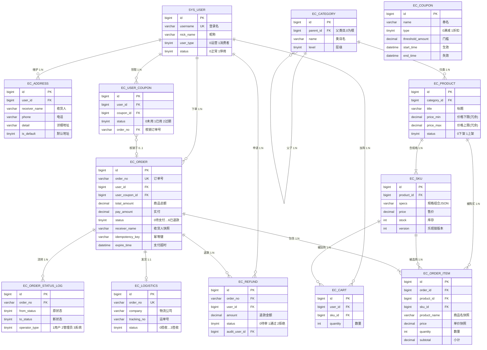
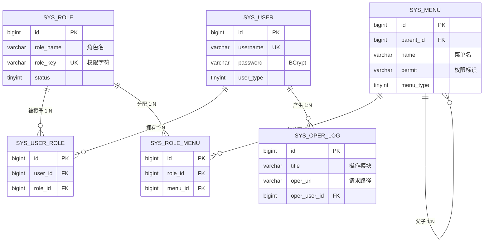
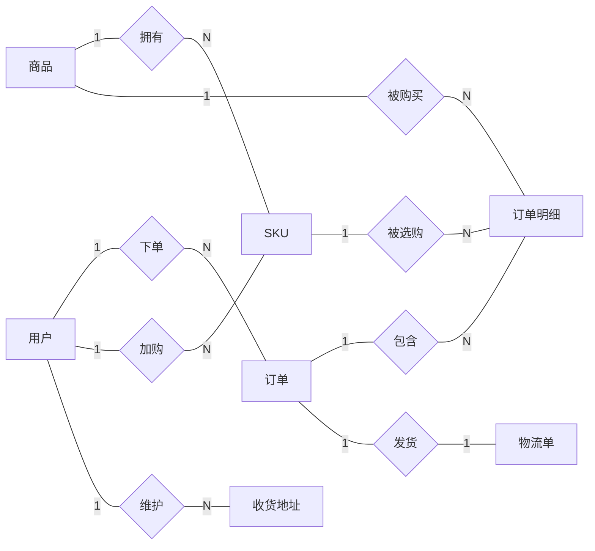

# 实验3 E-R 图（ecom 电商智能系统）

> 依据 `sql/ecom.sql`（31 张表）绘制。仓库无物理外键，图中 `FK` 为逻辑外键。
> 公共字段（`create_time` / `update_time` / `del_flag`）不在各实体中重复列出。

## 图1 核心交易 E-R 图

## 图2 系统权限 E-R 图（RBAC）

> 用户 ↔ 角色、角色 ↔ 菜单均为 M:N，已拆中间表 `sys_user_role`、`sys_role_menu`，并用唯一索引 `uk_user_role` / `uk_role_menu` 防重复授予。

## 图3 售后与智能运营 E-R 图

```mermaid
erDiagram
    EC_ORDER_ITEM ||--o| EC_REVIEW : "评价 1:1"
    EC_PRODUCT ||--o{ EC_REVIEW : "被评价 1:N"
    SYS_USER ||--o{ EC_REVIEW : "发表 1:N"

    EC_SKU ||--o{ EC_STOCK_ALERT : "触发预警 1:N"
    EC_SKU ||--o{ EC_SALES_FORECAST : "预测 1:N"
    EC_SKU ||--o{ EC_PRODUCT_SALES_DAILY : "日销 1:N"

    SYS_USER ||--o{ EC_CHAT_LOG : "咨询 1:N"
    SYS_USER ||--o{ EC_BEHAVIOR : "行为 1:N"
    SYS_USER ||--o{ EC_SEARCH_LOG : "搜索 1:N"

    EC_REVIEW {
        bigint id PK
        bigint order_item_id FK "一单一评"
        bigint user_id FK
        bigint product_id FK
        tinyint rating "1-5"
        varchar content "评价内容"
    }
    EC_STOCK_ALERT {
        bigint id PK
        bigint sku_id FK
        tinyint alert_type "0缺货 1积压"
        int current_stock "触发库存"
        tinyint status "0未处理 1已处理"
    }
    EC_SALES_FORECAST {
        bigint id PK
        bigint sku_id FK
        date forecast_date
        int forecast_qty "预测销量"
    }
    EC_PRODUCT_SALES_DAILY {
        bigint id PK
        date stat_date
        bigint sku_id FK
        int sales_qty "当日销量"
    }
    EC_CHAT_LOG {
        bigint id PK
        bigint user_id FK
        varchar question "用户问题"
        varchar answer "机器人回答"
        varchar source "rule/llm/transfer"
    }
    EC_BEHAVIOR {
        bigint id PK
        bigint user_id FK
        varchar event_type "expose/click/cart/order/pay"
        varchar target_type "product/sku/category"
        bigint target_id
    }
    EC_SEARCH_LOG {
        bigint id PK
        bigint user_id FK
        varchar keyword "关键词"
        int result_count "结果数"
    }
```

## 陈氏 E-R 图（核心实体）

矩形=实体，菱形=联系，椭圆=属性（属性见上文实体属性块，此处只画联系与基数）。

## 关系基数汇总

| 联系 | 类型 | 说明 |
|---|---|---|
| 用户—订单 | 1:N | 一名用户多笔订单，一笔订单只属于一名用户 |
| 订单—订单明细 | 1:N | 一笔订单至少一条明细；明细复合主键可用 (order_id, sku_id) |
| 商品—SKU | 1:N | SPU 与规格组合是典型主从 |
| 商品/SKU—订单明细 | 1:N | 商品可出现在多条明细中，使订单与商品构成 M:N |
| 订单—物流单 | 1:1 | 一笔订单对应一张运单，uk_order_no 保证唯一 |
| 订单明细—评价 | 1:1 | 一条明细最多一条评价，由 ec_review.order_item_id 控制 |
| 用户—角色 | M:N → sys_user_role | 中间表加唯一索引，防重复授权 |
| 角色—菜单 | M:N → sys_role_menu | 同上 |
| 用户—SKU（购物车） | M:N → ec_cart | uk_user_sku 保证同一 SKU 只占一行 |
| 用户—优惠券 | M:N → ec_user_coupon | 记录领取/核销状态与订单号 |

## 两点审查说明

1. **M:N 全部拆表**：user_role、role_menu、cart、user_coupon、order_item 五张中间表，对应实验要求的「M:N 拆中间表」。
2. **快照 ≠ 冗余**：ec_order 的 receiver_*、ec_order_item 的 product_name/price 是下单时快照（防止历史订单被后续修改污染）；ec_product.price_min/max 才是由 SKU 汇总、可重算的冗余（表注释已标「冗余自SKU」）。
